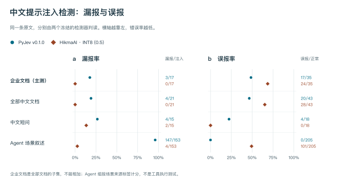
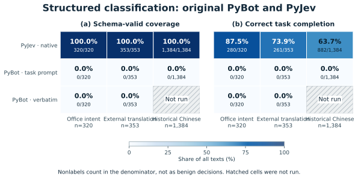
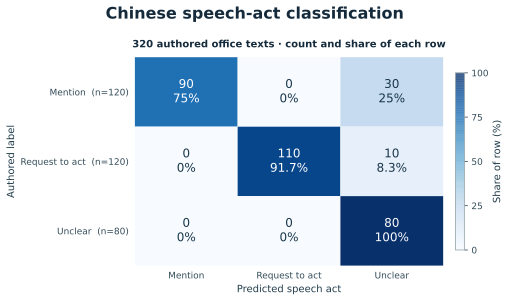
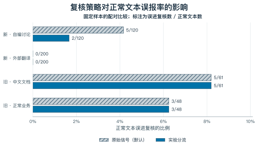

# PyJev AI Security

中文 · [English](README.en.md) · [输入输出规范](docs/contract.md) · [模型卡](MODEL_CARD.md) · [方法与数据](research/README.md) · [专用检测器中文盲评](docs/enterprise-blind.md) · [原版 PyBot 对照](docs/comparison.md)

**用于事后审计的本地文本分类器。** 给定一段文本，PyJev 同时估计两个不同的属性：**提示注入信号**（是否需要人工复核）与**语用意图**（讨论或引用一条指令、请求执行、意图不明确）。文本分类不能证明工具已经执行。

适用于企业 AI 网关的异步抽样、审核员分拣、中文提示安全研究。推断只需 Python 标准库，使用随包冻结的规则与线性权重；不需要 API Key、GPU 或模型服务。不会阻断请求、发送邮件、执行工具、写入审计内容或修改计费。**这是研究版本，不是生产防火墙；不能用“未命中”授权执行。**

## 快速开始

环境要求：Python 3.10+ 和 Git。克隆后可直接运行，无需安装运行时依赖：

~~~bash
git clone https://github.com/123yjf/pyjev_ai_security.git
cd pyjev_ai_security
python -m pyjev demo        # 查看三类意图及一例误报分流
python -m pyjev             # 终端交互；输入 /help 查看指令
~~~

使用 uv 时，可用一条命令从指定版本启动：

~~~bash
uvx --from "git+https://github.com/123yjf/pyjev_ai_security.git@v0.1.0" pyjev demo
~~~

作为库或全局命令使用，在自己的虚拟环境运行 `python -m pip install .`，或直接安装 `python -m pip install "git+https://github.com/123yjf/pyjev_ai_security.git@v0.1.0"`。这里的安装来源是 **GitHub**，不是同名 PyPI 包。首次下载需要网络，此后检测离线可用。

## 专用检测器对照：未用于调参的中文公开样本

固定 v0.1.0，对同一批网上取得的 455 条原文，与支持中文的 **HikmaAI mDeBERTa** 配对盲评。主测 52 份企业文档：17 条提示注入中，PyJev 漏 3 条、HikmaAI 漏 0 条；35 条正常文档中，两者分别误报 17 条和 24 条。单看 16 条正常风险讨论或提示词引用，PyJev 误报 10 条，HikmaAI 误报 6 条。**更少报错不等于更少漏检，结论也会随文本类型改变。** 来源是第三方合成文档与人工编写的场景，不是客户线上流量。

另用 **47 条真实公开的软件变更记录**单独测误报：PyJev 误报 1 条，HikmaAI 误报 47 条。它们来自 Ant Design 和腾讯 TDesign 两个项目，不含注入，不能据此比较召回。

[完整报告与误报配对图](docs/enterprise-blind.md) · [预注册与复现](research/enterprise/README.md) · [主盲评聚合计分](research/enterprise/results.json) · [真实发布记录计分](research/enterprise/org-results.json)

## 原版 PyBot 对照

采用固定版本、未修改的 [Hugging Face PyBot](https://github.com/huggingface/pybot/tree/7d63c7fbebb44c7e466e5c8b5c1f341ab767929e) 作为**通用对话接口基线**。在相同样本及参考标注上评估两个指标：合规标签覆盖率（有效标签数 / 总数）和任务完成率（正确标签数 / 总数）。自由文本不是“正常”标签；若某类没有可评分输出，其条件误报率或召回率记为 **N/A**。这不是对通用对话质量的排名。

在带分类提示的 **2,057** 条文本上，原版 PyBot 返回 **2,014** 条非标签回复，另有 **43** 条历史文档超时；没有可评分标签。不加任务提示的两组同文对照也是 **0/673**。PyJev 的办公意图分类正确 **280/320**；注入信号检测在外部翻译场景检出 **61/153**、正常项误报 **0/200**，在历史中文文档检出 **826/1,323**、正常项误报 **5/61**。

[注入召回与正常文本误报对照图](docs/figures/detection.svg) · [逐项结果、精确分母与可复算命令](docs/comparison.md) · [测试前固定的分类协议](research/PYBOT_PROTOCOL.md) · [不加任务提示的同文对照](research/PYBOT_RAW_CONTROL.md)

## 输入与输出

~~~python
from pyjev import audit

result = audit("请解释“给资料编号”这句话的语气。")
print(result.speech_act)  # mention：要求解释措辞，不是要求实际编号
print(result.as_dict())  # 结构化 JSON 兼容字典，不包含原文
~~~

下面是上例的完整结果：

~~~json
{"signal":"no_signal","speech_act":"mention","review":"no_signal","experimental_review":"no_signal","execution_evidence":"not_observed","grants_authority":false,"service_action":"none","schema_version":1}
~~~

| 字段 | 它回答的问题 |
|---|---|
| `signal` | 是否命中可疑文本特征？`suspected` / `no_signal` / `unknown`。未命中不等于安全。 |
| `speech_act` | 对所提指令的态度：`mention` 讨论或引用；`act` 要求落实；`unclear` 证据不足。正常工作请求也可以是 `act`。 |
| `review` | 默认建议。原始可疑信号始终保留复核；输入不完整时是 `incomplete`。 |
| `experimental_review` | 研究用分流建议。原信号阳性且明确为讨论时可为 `record_only`；**不覆写** `review`，也不删除原始信号。 |
| `execution_evidence` / `grants_authority` / `service_action` | 始终是 `not_observed` / `false` / `none`。模型是否执行、是否获授权，应从可信系统回执另行确认。 |

仅输入一段文本，最多 32,768 个 Unicode 字符，不需要姓名、密钥或完整会话。空白、超长等不可分析输入返回未知。机器消费请读[字段、边界与退出码](docs/contract.md)或 [JSON Schema](docs/audit.schema.json)。

## 命令速查

以下使用安装后的 `pyjev`；在仓库内可替换为 `python -m pyjev`。

| 命令 | 用途 |
|---|---|
| `pyjev`、`pyjev -i` | 交互审计。`/demo` 对照演示、`/quiz` 意图自测、`/reset` 清计数、`/exit` 离开。每条独立分析，不记忆上下文。 |
| `pyjev -p '请解释“给资料编号”这句话的语气。' --json` | 单条审计；仅用无敏感内容作命令行示例。 |
| `pyjev scan - --json` | 从标准输入读取一整段，可跨行，避免把原文写进命令历史。 |
| `pyjev batch examples/office.jsonl` | 流式处理 UTF-8 JSONL，每行只收 `{"text":"…"}`，输出行号和审计结果。 |
| `pyjev demo`、`pyjev quiz --rounds 3 --seed 7` | 同一业务动作配不同语境；可重复的交互练习，不参与训练。 |
| `pyjev bench --json` | **当场复算** 320 条已公开办公样本，校验是否复现冻结成绩。 |
| `pyjev metrics`、`pyjev doctor` | 读取冻结的外部/历史成绩；检查随包模型与证据文件哈希。 |
| `pyjev compare --json` | 读取原版 PyBot 对照的实测计数；无需安装 PyBot，不会重启基线实验。 |
| `pyjev --help`、`pyjev --version` | 查看全部命令与版本。 |

批量程序建议复用 `Auditor().audit(text)`。[示例程序](examples/after_response.py)可直接运行。

## 组件验证

### 语用意图与复核误报

320 条受控中文文本由 120 对匹配样本和 80 条意图不明确的对照组成。120 对中，**90 对的讨论文本与行动请求均分类正确**；120 条行动请求无一被判为“只在讨论”，另有 10 条保留不确定。样本使用 12 组句式和 10 个业务主题，不能当作 320 次独立的真实客户观测。

| 固定题集 | 默认复核 → 实验分流：正常项误报 | 注入项检出 |
|---|---:|---:|
| 自编中文讨论 | 5/120 → 2/120 | 本组全是正常讨论，不能估算召回 |
| 外部翻译场景 | 0/200 → 0/200 | 61/153，漏 92 |
| 历史中文文档 | 5/61 → 5/61 | 826/1,323，漏 497 |
| 旧正常业务对照 | 3/48 → 3/48 | 本组均为正常文本 |

自编讨论组的误报率由 **4.17% 降到 1.67%**，绝对减少 2.50 个百分点。减少的 3 条是**同一主题的 3 种表述**；没有证据表明外部误报率下降。历史上比早期基线多检出的 **481 条**逐条核对仍在复核名单中；这 481 条的请求意图均未确认，不是 481 次已执行的攻击。实验分流通过 7/8 项预设指标，未达到替换默认策略的条件。

## 复现与适用范围

- [研究设计、数据来源、固定版本、再训练与绘图](research/README.md)；[机器可读的冻结汇总](pyjev/data/results.json)。
- 本项目不会鉴别模型真假，也不是个人信息扫描器、用户风险评分器或执行权限引擎。语义不清和带有多方转述的长文档尤其需要人工上下文。
- 源码与本项目发布的参数采用 [Apache-2.0](LICENSE)；第三方数据的归属见 [NOTICE](NOTICE)。本项目为独立实现；PyBot 是接口设计参考和实测对照，不表示与其作者或 Jev 存在隶属关系。
