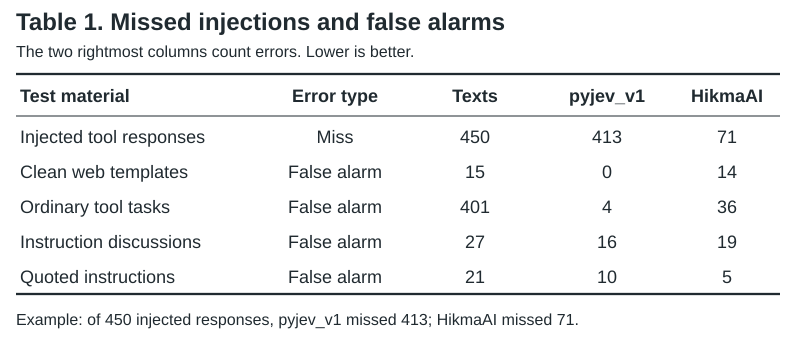
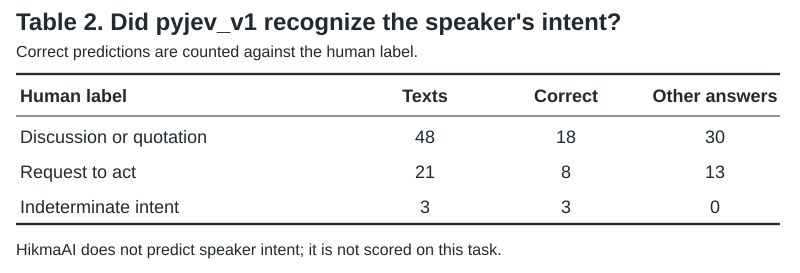

# Post-response security auditing at an enterprise AI gateway

## 1. Which decisions can a gateway make?

An enterprise gateway can observe a user request, a retrieved document and a model's proposed tool call. It often lacks the provider's weights, the customer's authorization rules and the tool's execution receipt. A request to act, permission to act and an action actually taken are therefore three different observations. The same sentence can appear in a user instruction or in a ticket about an incident. Treating both as attacks creates work for reviewers; treating both as harmless can hide an injection. [OWASP application risks](https://genai.owasp.org/llm-top-10/)

## 2. Existing defenses and their deployment boundaries

| Problem | Representative method and evidence | What a gateway still cannot infer |
|---|---|---|
| Harmful content and jailbreaks | [WildGuard / WildGuardMix](https://arxiv.org/abs/2406.18495) distinguishes harmful prompts, harmful responses and refusals. | A harmless instruction can still be unauthorized. |
| Instructions embedded in data | [Azure Prompt Shields](https://learn.microsoft.com/en-us/azure/ai-services/content-safety/concepts/jailbreak-detection) covers user prompts and external documents. [BIPIA](https://arxiv.org/abs/2312.14197) evaluates indirect injection. | A suspicious quotation does not establish that its author is issuing that command. |
| Tool misuse | [CaMeL](https://arxiv.org/abs/2503.18813) separates trusted control flow from untrusted data. [AgentDojo](https://arxiv.org/abs/2406.13352) measures security and task completion in tool environments. | Enforcing authorization requires integration with the executor. Text is not an execution receipt. |
| Sensitive data exposure | [Bedrock Guardrails](https://docs.aws.amazon.com/bedrock/latest/userguide/guardrails.html) can detect or mask sensitive entities. [TAB](https://aclanthology.org/2022.cl-4.19/) annotates anonymization in English legal documents. | Identifying a name does not determine whether a recipient may see it. |
| Channel and model identity | [LLMmap](https://www.usenix.org/conference/usenixsecurity25/presentation/pasquini) uses behavioral fingerprints to identify candidate models. | Behavioral similarity is not provenance for a particular request. |

These approaches already have commercial uses. The practical question is where an enterprise can afford to apply them. Some [Cloudflare AI Gateway endpoints](https://developers.cloudflare.com/ai-gateway/features/guardrails/usage-considerations/) buffer responses for inspection; [LiteLLM](https://docs.litellm.ai/docs/proxy/guardrails/quick_start) already offers logging-only detection. **Post-response placement is not itself novel.** The question here is how much useful context an inexpensive local audit adds and how often it is wrong.

## 3. Method: distinguish evidence, intent and review

pyjev_v1 combines bilingual lexical signals and fixed, learned sparse weights with a discourse parser for quoted material, surrounding requests and incident reports. It returns three inspectable fields: `signal`, `speech_act` and `route`. For example, explaining a quoted instruction and asking someone to carry it out are different speech acts; neither is automatically malicious. This is a structured explanation of a review decision, not token-level attribution, model identification or proof of execution. [Output contract and cases](start-local.md#examples)

## 4. How does it compare with a specialist?

Both detectors received the same **924 public Chinese texts** after the settings and corpus were frozen. The comparison includes InjectAgent-CN tool responses, matched clean templates, ACEBench tasks, DAIR.AI guidance and a separately scored incident-report group. These are not customer logs. [HikmaAI mDeBERTa](https://huggingface.co/HikmaAI/hikmaai-mdeberta-v3-base-prompt-injection) used an INT8 CPU model and a threshold of 0.5. [Protocol](../research/scope_study/PROTOCOL.md) · [Pinned sources](../research/scope_study/sources.json)

pyjev_v1 caught **37/450** injected responses (8.2%); HikmaAI caught **379/450** (84.2%). The apparent benefit of fewer ordinary-task alerts comes with a large loss in recall. The 450 responses share 15 templates, so they are not 450 independent scenarios.

**Intent is a separate task.** Of 48 discussions or quotations, pyjev_v1 correctly recognized 18; 26 were indeterminate and four were called requests to act. The specialist does not output these intent labels. In historical regression, all 481 designated injection detections still reached review, but the system made more errors on the older office-intent suite. [Copyable tables and limitations](scope-blind.md)

## 5. How much computation does an audit require?

Apple M4, CPython 3.11.5, CPU only, batch size one. Each detector processed the same 924 short texts in three fresh processes. Twelve warm-up inputs per process were excluded. HikmaAI timing includes tokenization and inference; peak RSS is total process memory, not the model file size.

| Detector | Median (ms/text) | p95 (ms/text) | Mean CPU time (ms/text) | Peak RSS (MiB) |
|---|---:|---:|---:|---:|
| pyjev_v1 | 0.276 | 0.706 | 0.319 | 33.0 |
| HikmaAI INT8 / CPU | 16.617 | 44.846 | 39.595 | 1,299.9 |

**Finding:** pyjev_v1 is a low-cost way to annotate material for review, not a substitute for a specialist injection detector. These are local timings, not production first-token latency, and the Chinese evaluation is not an English accuracy benchmark. [Timing records](../research/footprint/observed-m4.json) · [Reproduction](../research/footprint/README.md) · [Deployment](start-local.md)
