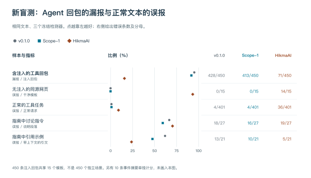
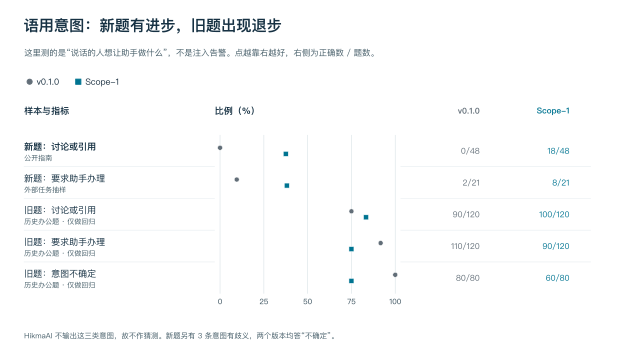

# 面向企业 AI 网关的轻量事后审计：指令语境、复核误差与 CPU 开销

**研究问题。** 网关已经把回答发给客户。此时有一段获准审计的文字：哪些值得交给审核员？哪些只是在讨论某条指令？我们研究的是**事后分拣**，不是在响应途中阻断请求，也不是根据文字推断一个人是否实施了攻击。

**主要发现。** 在同一台 Apple M4、同一批 924 条公开短文本上，Scope-1 每条审计的中位耗时为 **0.276 毫秒**，CPU 版专用分类器 HikmaAI 为 **16.617 毫秒**。但在其中 450 条带注入的工具回包上，前者漏了 **413 条**，后者漏了 **71 条**。一个系统确实可以便宜到适合本地逐条分析，却仍然不适合决定哪些回包可以不再检查。以下分别检验这两个命题。

## 1　为什么要分开判断“写了什么”和“要谁去做”

比较两句只改变外层要求的话：

| 输入给同一个检测器的文字 | Scope-1 判定的意图 | 是否建议送审 |
|---|---|---|
| 请解释引文“给会议记录编号”的语气。 | `mention`：讨论引文 | 否 |
| 请按引文中的要求去做：“给会议记录编号”。 | `act`：要求办理 | 否 |

引文里的动作完全相同。只看到“编号”，无法区分谁要做什么；即便判断出用户确实要助手办理，“编号”仍是正常工作。还有第三种情况：工单记载一封外部邮件曾要求助手把内部资料交给陌生人。这里**值得复核的是被记载的事件**，不能归罪于写工单的人。三个例子均为自编，用来解释接口，不作为准确率证据。[可运行输入、两种版本的完整返回](../examples/audit-output.json)

这决定了输入输出契约：一次只读一段文字；分开返回**可疑线索**、**文字意图**、**复核建议**。程序没有工具执行回执、用户授权凭证或可信消息角色，所以不输出“攻击成功”“用户越权”“模型为假”。输出也不调用工具、不写审计日志、不发邮件、不改计费。若未来接入网关，应由调用方在响应完成后，用独立队列传入最小必要文本；队列不是这个库已实现的功能。

## 2　为什么从词表走到上下文，而不是只增加规则

第一步是把可疑表述识别为复核线索。v0.1.0 保留双语词表提供的特征，再用训练所得的稀疏线性权重为词和短字符片段组合打分。推断时读取冻结的数值参数；它既不是按关键字逐字封禁，也不是调用大模型生成解释。第二个分类任务单独看外层表述：先区分引文与外层要求，再判断是在解释、要求办理还是无法确定。**词表和学习权重解决“像不像可疑表述”；语境层解决“这是谁的话”。**

**表 1　加入稀疏信号组件究竟得到什么？** 固定历史题，改变信号组件。分子是条数，不是百分数。这里的历史题是组件对照，不是对未知流量的证明。

| 组件 | 中文历史注入检出 / 1,323 | 中文历史正常误报 / 61 | 另一组翻译场景检出 / 153 | 同组正常误报 / 200 |
|---|---:|---:|---:|---:|
| 仅双语词表特征 | 345 | 2 | 28 | 0 |
| 加入冻结的稀疏线性分类器 | 826 | 5 | 61 | 0 |

第二行比第一行在中文材料中多检出 **481 条**，代价是 **3 条额外误报**。因此“826”不是越大越好，更不是 826 起已经发生的攻击：它是既定标注下找回了多少条。这个取舍引出了 Scope-1：保留原版信号，同时分析外层说话者、引文边界、工具回包中的内容和事件转述，给出普通复核、事件复核或仅记录语境等不同建议。`original_signal` 和 `original_review` 始终可对照。候选是**另一个显式入口**，没有替换默认版本。[组件对照原始计数](../research/signal-controls.json) · [冻结模型卡](../MODEL_CARD.md)

## 3　区分语境之后，在没用于本轮改程序的材料上是否更可靠？

先冻结 v0.1.0、Scope-1 与 HikmaAI 的版本及阈值（0.5），再固定输入和参考标签、生成预测，最后合并答案计分。三者看到的是同一段未带答案的文字。主分析有 **914 条**：450 条注入工具回包与 464 条正常材料；另有 10 条历史事件描述，避免把“认出事故报道”错算为“抓到正在发生的注入”。实测材料是公开基准与文档，不是客户日志，也无法证明第三方模型预训练时从未见过它们。[固定来源](../research/scope_study/sources.json) · [预先确定的计分与取样方法](../research/scope_study/PROTOCOL.md)

**图 1　同一检测器的错误随文本类型改变。** 阳性组读**漏报**，正常组读**误报**，两者均是越少越好。每格的分母不同，不能将五类误差简单取平均。

在 450 条注入回包上，原版、候选、HikmaAI 分别漏 **428、413、71** 条；在 401 条正常工具任务上，则分别误报 **4、4、36** 条。候选减少了 15 次漏报，没有丢掉原版在这批回包中检出的 22 条。它的误报较少，**不能反推检测能力更强**：它本来就更少报警。450 条阳性来自 15 个模板各 30 条，不是 450 个独立企业或独立场景。[图 1 完整数表与模板级核查](scope-blind.md)

讨论与引用也不可合并后就宣布胜负。在 27 条正常讨论中，候选误报 **16** 条，HikmaAI **19** 条；在 21 条正常引用中，候选误报 **10** 条，HikmaAI **5** 条。换到另一种文体，两者的相对表现就反过来了。

**图 2　“没有报警”和“理解了引用”是两个指标。** 在 48 条有人工意图标注的讨论与引用里，候选明确答对 18 条；原版是 0 条。候选其余 30 条中，26 条保留不确定，4 条被错读为要求执行。HikmaAI 不输出这个三分类标签，不能拿它的注入分数充当意图答案。

历史回归决定是否晋升。候选保留了指定的 **481/481** 条历史复核命中，旧 Agent 题的漏报从 **147/153** 降至 **140/153**。但 320 条旧办公意图题的正确数由 **280 降到 250**：40 条原本正确的判断被改错，只找回 10 条。**注入命中得以保留，不等于意图能力没有退步。Scope-1 不替换 v0.1.0。** 原版 PyBot 是对话接口对照，不输出这套安全标签；不将它列为“召回率为零”的分类器。[逐项回归证据](../research/scope_study/regression.json) · [PyBot 对照](comparison.md)

## 4　“轻量”能不能用墙钟时间和资源用量证明？

检测效果并不证明计算成本。为此只改变检测器，在同一台 **Apple M4（10 个逻辑 CPU、16 GiB 内存），macOS 26.2 arm64，CPython 3.11.5** 上重放相同的 924 条文本。三种系统均只用 CPU，逐条、串行、批大小为 1；HikmaAI 使用量化 ONNX，包含分词及分类推断，算子内 2 线程、算子间 1 线程，不包含网络下载。每个系统用 3 个新进程各跑一遍，轮换先后顺序；每进程先做 12 次相同预热，不计入延迟。这是 **924 条不同材料**，不是 2,772 条新的质量测试题。

**表 2　在相同输入上测出的资源开销。** p50 表示一半输入不超过该耗时，p95 表示 95% 不超过；CPU 时间累计进程所有线程，因而可高于墙钟耗时。内存是包含解释器和模型在内的进程峰值，不是模型文件大小。

| 检测器 | 单条 p50（ms） | 单条 p95（ms） | 平均 CPU 时间（ms／条） | 进程峰值 RSS（MiB） |
|---|---:|---:|---:|---:|
| PyJev v0.1.0 | 0.218 | 0.517 | 0.248 | 32.4 |
| Scope-1 | 0.276 | 0.706 | 0.319 | 33.0 |
| HikmaAI INT8／CPU | 16.617 | 44.846 | 39.595 | 1,299.9 |

HikmaAI 的单条中位耗时约为候选的 **60.1 倍**，进程峰值内存约为 **39.4 倍**。两种 PyJev 共用的推断参数文件为 1,407,295 字节；HikmaAI 的 ONNX 与分词器文件合计 354,805,446 字节。文件大小不含代码、解释器或依赖，不能用来替代 RSS。审计速度是有证据的优势；结合图 1，不能把它写成“以更小算力达到相同检出效果”。[逐轮原始汇总、p99、装载时间和串行速率](../research/footprint/observed-m4.json) · [计时代码](../research/footprint/measure.py)

边界：这些是短文本（中位 99、p95 为 263、最长 822 个 Unicode 字符），不足以给 32,768 字符的接口上限估速。未测生产流量、并发、队列、端到端 TTFT、GPU、能耗或人工审核工时。不同硬件和文本长度应重测，不把 60.1 倍写成产品承诺。

## 5　结论、使用决策与下一项实验

PyJev 当前最有证据支持的用途是：**无需把正文再发给第三方，便能以较小的本地 CPU 和内存开销，给每段文本附上一条可读的复核理由类别。** 对企业有价值的分界不是“能不能识别所有攻击”，而是“哪些判断可低成本提供，哪些必须保留给专用检测器或人”。适合离线抽样与审核试验，不适合作执行许可、客户定责或唯一防线。尤其不要用“PyJev 阴性”作为跳过工具回包独立检查的条件；这会排除本次漏掉的 413 条。也不能把两种检测器的检出数相加，宣称已验证组合系统。

下一项值得做的实验不是再报一个总准确率：在获授权、去标识并由多人独立标注的真实工作流中，按“外部工具回包、正常任务、内部安全讨论”分层，配对比较**每千条误送审数、漏过的阳性数、人工复核分钟数**。若评估接入代价，再在进程外独立测峰值队列长度和业务请求 p95。上述均为待验证假设，不是本次成果。已公开的 924 条今后只作回归，不再当作新盲集。

**复现入口。** [从获取源码，到读懂第一条输出，再到完整复算](start-local.md) · [逐条预测、输入和标签摘要一致的本地回执](../research/footprint/replay-receipt.json)。
