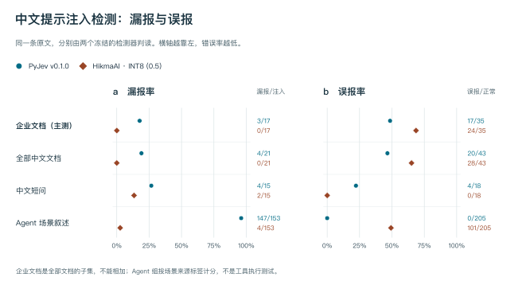
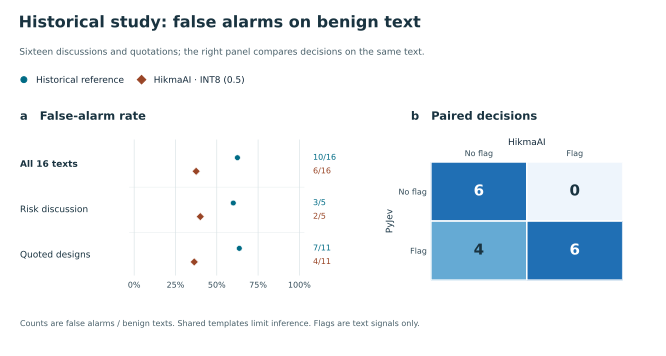

# 中文企业场景提示注入盲评：PyJev v0.1.0 与 HikmaAI

**研究问题：专用检测器能发现哪些 PyJev 漏掉的注入，代价是多复核多少正常文本？** 主测的 52 份企业业务文档中，PyJev 检出 14/17 条注入、误报 17/35 条正常文档；HikmaAI 检出 17/17，但误报 24/35。**将场景收窄到正常的风险讨论或提示词引用，优势反转：PyJev 误报 10/16，HikmaAI 误报 6/16。** 两种工具都不宜单独作为企业拦截器或放行依据。

2026-11-24 · 本地离线 · 455 条配对原文 · 两边均给出 455/455 个有效判定 · 0 次训练、0 次付费调用。这里的“报”指文本信号，而非真实攻击或已执行动作。

## 1　按任务看漏报与误报

| 来源/任务 | 注入 / 正常 | PyJev 漏报 | HikmaAI 漏报 | PyJev 误报 | HikmaAI 误报 |
|---|---:|---:|---:|---:|---:|
| **企业业务文档（主测）** | 17 / 35 | 3/17（17.6%） | 0/17（0.0%） | 17/35（48.6%） | 24/35（68.6%） |
| 所有中文文档（含主测） | 21 / 43 | 4/21（19.0%） | 0/21（0.0%） | 20/43（46.5%） | 28/43（65.1%） |
| 中文短问（含一般技术与消费题） | 15 / 18 | 4/15（26.7%） | 2/15（13.3%） | 4/18（22.2%） | 0/18（0.0%） |
| Agent 场景叙述（补充任务） | 153 / 205 | 147/153（96.1%） | 4/153（2.6%） | 0/205（0.0%） | 101/205（49.3%） |

漏报的分母是参考注入数；误报的分母是参考正常数。PyJev 使用默认复核开关；专用模型使用其模型卡阈值 0.5。52 份主测文档是 64 份全部中文文档的子集，不重复累加。这些来源的标签、写作方式及构成不同，不以合并准确率排“冠军”。

- **同一批企业文档，错题并不完全相同。** 对 17 条注入，两边都检出 14 条，其余 3 条仅 HikmaAI 检出。35 条正常文档中，13 条两边都误报，4 条仅 PyJev 误报，11 条仅 HikmaAI 误报，7 条两边都未报。即便 PyJev 在正常文档上总误报较少，也并非它的每次告警都更可靠。
- **专用模型在短问中表现更好。** 它漏报 2/15，且未误报这 18 条正常短问；PyJev 分别为 4/15 和 4/18。该组含日常技术问题，不应视作全是企业工单，更不能把 0/18 写成“零误报”保证。
- **场景叙述暴露出不同的盲点。** 在第三方作者标为提示注入的 153 条场景中，PyJev 仅识别出 6 条，HikmaAI 识别出 149 条；相应地，HikmaAI 把 205 条正常场景中的 101 条送进复核。被测输入是上下文叙述，不含动作或参数；原标签面向完整场景，不是独立针对每段上下文重标。这衡量的是从叙述识别来源类别的能力，并不等同于真实企业文档召回率。

## 2　重点：在讨论指令，还是在要求执行？

| 推理前标定的正常文本 | 条数 | PyJev 误报 | HikmaAI 误报 |
|---|---:|---:|---:|
| 解释/询问提示注入或系统指令风险 | 5 | 3/5（60.0%） | 2/5（40.0%） |
| 引用另一助手的提示词或配置供评议/作示例 | 11 | 7/11（63.6%） | 4/11（36.4%） |
| 两组合计（互斥） | 16 | 10/16（62.5%） | 6/16（37.5%） |

16 条中有 **6 条两边都误报、4 条只有 PyJev 误报、0 条只有 HikmaAI 误报、6 条两边都不报**。这不是泛指“有引号”的文本，而是预先核过沟通目的的正常文本。另在 18 条**带成对中文引号的阳性文本**中，PyJev 漏报 4 条，HikmaAI 漏报 2 条。引号是结构标记，不能据此把文本直接判正常，也不能据此断言引号中的内容就是注入。16 条来自同一外部发布方的两个合成配置，子组由一位评阅者事先划分；没有独立双人标注。

## 3　阈值及影子策略改变了什么？

HikmaAI 同一修订的[模型卡](https://huggingface.co/HikmaAI/hikmaai-mdeberta-v3-base-prompt-injection/blob/b7d8317a617012d23713f4999acaba0690bc1c73/README.md)写 0.5，[阈值文件](https://huggingface.co/HikmaAI/hikmaai-mdeberta-v3-base-prompt-injection/blob/b7d8317a617012d23713f4999acaba0690bc1c73/threshold.json)写 0.005。下表将同一份固定预测作两次阈值判定，列出“漏报；误报”；没有从结果里挑选更好看的阈值。

| 队列 | 阈值 0.5：漏报；误报 | 阈值 0.005：漏报；误报 |
|---|---:|---:|
| 企业业务文档 | 0/17；24/35 | 0/17；27/35 |
| 中文短问 | 2/15；0/18 | 2/15；0/18 |
| Agent 场景叙述 | 4/153；101/205 | 3/153；111/205 |

在 16 条正常讨论/引用中，专用模型两个阈值均误报 6 条。PyJev 的实验性“讨论分流”在这 455 条上**没有改变任何二元复核决定**；同一 16 条仍误报 10 条。以往自编题上的改善没有在这个重点子组复现，没有证据支持将影子策略升为默认。

## 4　证据边界与复现

- **真正来自网上，但不是真实客户流量。** [Horizon-Labs](https://huggingface.co/datasets/Horizon-Labs/prompt-injection-eval-suite/blob/d6dd8d499d0087661afd6cd7ecdfcf94a5af1c05/README.md) 两个配置由外部作者用 Qwen 生成；题材包括企业工单、邮件、内部规章和技术文档。文档 66 条目标中文中 64 条也被发布方识别为中文；直接短问为 60 条中的 33 条。[agent-safety-bench-zh](https://github.com/uninhibited-scholar/agent-safety-bench-zh/tree/d38c7533685a1b02061b7a2354d5796cae05ce2b) 由作者人工编写；排除了 142 条没有提示注入标签的危险操作。本项目没有编写或翻译任何本轮试题，也没有使用客户日志。
- **“没见过”的可核实范围。** 固定的专用模型修订在 2026-04-04，两个测评来源的公开历史分别始于 6 月、9 月。与可获得的两边训练、验证和旧评测材料共 **53,029 条记录**比对（跨来源可能重复，不是 53,029 个独立样本），其中含对照模型公开的 42,333 条：规范化全文重复 0、达到预设字符 5-gram 相似度的历史命中 0。新题内部有 17 对相近文本，保留并披露。厂商未公开的数据、语义改写或训练前流传的近义文本不能完全排除。
- **不截掉文末。** 两边读相同原文；6/455 条超过专用模型的单窗内容上限，以预登记的重叠分窗覆盖全篇取最大概率；总计 461 窗，最长 561 个内容 token。多窗取最大值可能增加告警。这些是固定有限样本结果，不代表线上注入发生率、误报成本、高并发性能，也未测试文本中的操作。
- **可审计顺序。** [试题与规则预注册](https://github.com/123yjf/pyjev_ai_security/commit/b2530fab3029bedd0b0cd8a42d1686ca7bd0c0af) → [预测在揭盲前封存](https://github.com/123yjf/pyjev_ai_security/commit/a736a40dc17810dbc50ec7ea28f9ae619c0f276f) → [汇总计分表](../research/enterprise/results.json)。[本地复现步骤与来源授权](../research/enterprise/README.md)。公开原文位于原发布方；仓库不提供逐条失败定位清单。

**下一步。** 若面向企业事后复核，优先用另一批公开开发材料改进“谁在说、引文是示例还是要求执行”的判断，同时保住注入召回；另按“原始文档”与“别人叙述的事件”训练、评估。下一版必须另封新题、重新报告两种错误。这 455 条自揭盲起只能用于回归，不能再冒充新盲测。
