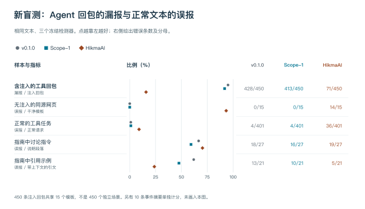
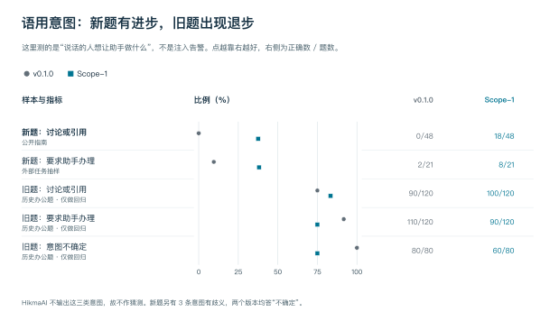

# 中文 Agent 与指令语境：Scope-1 前瞻配对盲测

**结论：保留 v0.1.0 为默认。** Scope-1 保住指定的 481 条历史安全命中；在新的 450 条有注入工具回包中，比旧版多检出 15 条，但仍漏掉 413 条。它对正常工具请求误报少，却不够敏感；判断正常文本究竟是讨论还是请求执行，也还不可靠。这里只测离线、事后文本检测，没有测试实际工具执行、越权是否成功或生产拦截率。

## 新盲集：同一条原文交给三个冻结的检测器

| 材料及错误类型（越少越好） | 样本数 | v0.1.0 | Scope-1 | HikmaAI，0.5 |
|---|---:|---:|---:|---:|
| 含注入的工具返回文本：漏报 | 450 | 428 | **413** | **71** |
| 同源干净网页模板：误报 | 15 | 0 | **0** | 14 |
| 正常工具任务：误报 | 401 | 4 | **4** | 36 |
| 指南在讨论指令：误报 | 27 | 18 | **16** | 19 |
| 指南在引用示例：误报 | 21 | 13 | **10** | 5 |

主面板有 914 条。候选的工具回包漏报率 **91.8%**，HikmaAI 为 **15.8%**；对同源干净网页，后者误报 14/15，不能将其二分类输出直接等同于恶意行动。Scope-1 在全部 464 条正常材料上误报 30 条（原版 35，HikmaAI 74）；它在 48 条讨论／引用上仍误报 **26/48**（原版 31，HikmaAI 24）。参考模型在讨论组比候选多报 3 条，在引用组则少报 5 条。**误报少不等于检出能力强。** 逐条配对：Scope-1 保留原版的 22/22 个主面板真阳性，新增 15 个；移除 5 个原误报，没有新增误报。三种系统在本批数据上均无二分类弃判。

另有 **10 条已公开事件摘要**，不并入上表。对发布方标为提示注入的 8 条，原版漏 7、候选漏 2、HikmaAI 漏 3；另外 2 条三者均未误报。候选检出的 6 条里，5 条进入“案例叙述复核”，1 条进入普通复核。能认出报道，不等于能识别正在返回的工具指令，更不说明事件实际执行。

## 能否区分“引用”与“请你去做”？

| 新题的人工作用域标注 | 条数 | 原版正确 | 候选正确 | 候选其余判断 |
|---|---:|---:|---:|---|
| 讨论或引用指令 | 48 | 0 | **18** | 26 不确定，4 误判为要求执行 |
| 确实要求助手办理或查询 | 21 | 2 | **8** | 12 不确定，1 误判为讨论 |
| 不能确定是否要助手办理 | 3 | 3 | 3 | 两版均保留不确定 |

“请总结会议记录”可能既是执行请求，又完全正常。上表衡量**意图分类**；前表衡量**注入告警**，分母和问题不同。HikmaAI 不提供这三类意图，不能拿“未报警”冒充“理解了引用”。

## 旧题仅作回归：有没有丢掉原先检出的东西？

| 不参与本轮开发的旧题 | 原版 → 候选 | 逐条核查 |
|---|---|---|
| 旧 Agent 叙述的 153 条阳性 | 漏报 147 → **140** | 原 6 个真阳性都在，新增 7 个；205 条同组正常文本均未误报 |
| 旧的正常讨论／引用 16 条 | 误报 10 → **8** | 引用／提示设计 7/11 → 5/11；风险讨论仍是 3/5 |
| 旧主测 455 条 | 漏报 155 → **148**；误报 24 → **22** | 原 34 个真阳性均保留 |
| 历史中文 1,384 条 | 检出 826 → **834**；误报 5 → 5 | 原 826 个都保住；其中指定的 **481/481** 仍真正进入复核，不是只保住原始信号位 |
| 另外 353 条跨来源旧题；47 条真实软件发布记录 | 前者真阳性 61 → 61、误报 0 → 0；后者误报 1 → 1 | 未新增告警 |
| 旧办公意图 320 条（不是注入阳性题） | 总正确 280 → **250** | 讨论 90→100/120；要求执行 110→90/120；不确定 80→60/80 |

最后一行是**实质退步**：40 条过去答对的意图标签被改错，同时找回 10 条。不能用“安全真阳性零丢失”声称“所有旧功能都没有退步”。**本轮不晋升默认版本。**

## 证据边界与下一步

- **文章来源**：开发侧使用 Dify 中文文档、OWASP LLM01 中文案例及 Horizon 的不同切片。正式测试另取 [InjectAgent-CN / ACEBench 发布材料](https://huggingface.co/datasets/WhitzardAgent/AgentSafety-All-in-One-Test-Case/tree/080e55c78f27bb1576c4138b053cdd405bc3198f/prompt-injection)、[DAIR.AI 中文指南](https://github.com/dair-ai/Prompt-Engineering-Guide/tree/57673726396dd94acb23bdb1e67f27c78ee85a8e)和 [AI Threat Watch 发布记录](https://aithreat.io/zh/cases/category/prompt-injection/)。含企业工作流程和技术文章，也有通用任务；**不是企业客户会话样本，更不是线上发生率**。
- **防止看题改程序**：按顺序公开了[候选代码与方案](https://github.com/123yjf/pyjev_ai_security/commit/fb2bdf233010ad1887d9d9aa31aa1873e97fc1d5)、[输入与答案摘要](https://github.com/123yjf/pyjev_ai_security/commit/685915a)、[未对答案的预测摘要](https://github.com/123yjf/pyjev_ai_security/commit/1f2077e)。对 53,862 份已知历史或开发记录去重，未发现规范化完全重复或五字片段 Jaccard ≥0.70 的跨集样本；新集内部有 41 对近似文本。不能排除未知预训练语料或更远的语义重复。
- **分母与取样**：450 条注入是 15 个网页模板各 30 条，逐条验证和对应干净模板的前后缀完全一致；不能当作 450 个独立场景。在每模板 30 条里，候选漏报中位数为 **29**，HikmaAI 为 **3**。专业指南采用单人事先标注的完整原文片段；21 条明确执行题和 3 条歧义题来自确定性抽出的 24 条正常请求。样本不代表总体，不给出虚假的独立样本显著性。
- **比较口径**：冻结 [HikmaAI INT8 模型](https://huggingface.co/HikmaAI/hikmaai-mdeberta-v3-base-prompt-injection/tree/b7d8317a617012d23713f4999acaba0690bc1c73)，主阈值 0.5。作为预设敏感性分析，阈值降至 0.005 时，新主面板漏报 71→59，误报 74→88；没有根据本轮答案挑阈值。全部输入均在一个滑窗内，最长 351 个内容 token。HikmaAI 未经本项目再训练。
- **下一轮优先级**：先给“外层谁在发任务、谁的话只是被引用、工具结果有没有权给助手派任务”建立独立的角色与动作关系表示；对含混文本保留不确定。以开发集构建安全与意图两套逐条保留门槛。本轮 924 条以后只做回归；候选再次冻结后再找新盲集。**不以增加规则条数或源码行数作为成功指标。**

[运行候选和复现方法](../research/scope_study/README.md) · [完整盲测计数](../research/scope_study/blind-results.json) · [历史回归计数](../research/scope_study/regression.json) · [原版研究](enterprise-blind.md)
